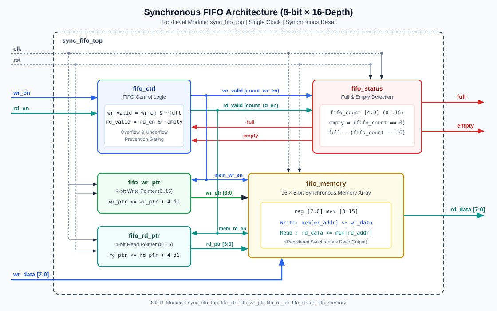

# Synchronous FIFO Memory Design (Verilog HDL)

A modular, synthesizable **8-bit × 16-depth Synchronous FIFO (First-In, First-Out)** memory designed in **Verilog-2001 HDL** with a self-checking testbench, Vivado XSIM simulation scripts, XDC timing constraints, and Vivado RTL synthesis scripts.



---

## Specifications

| Parameter | Value |
| :--- | :--- |
| **FIFO Type** | Synchronous FIFO (Single Clock Domain) |
| **Data Width** | 8 bits (`[7:0]`) |
| **FIFO Depth** | 16 locations (`0..15`) |
| **Address Width** | 4 bits (`[3:0]`) |
| **Clock** | Single rising-edge clock (`clk`) |
| **Reset** | Active-high synchronous reset (`rst`) |
| **Control Inputs** | `wr_en` (Write Enable), `rd_en` (Read Enable) |
| **Status Flags** | `full` (16 entries), `empty` (0 entries) |
| **Target Toolchain** | Xilinx Vivado & Vivado Simulator (XSIM) |

---

## Repository Structure

```text
FIFO_Memory_Design/
├── rtl/
│   ├── fifo_memory.v          # 16 x 8 synchronous memory array + registered read output
│   ├── fifo_wr_ptr.v          # 4-bit write pointer with modulo-16 wraparound
│   ├── fifo_rd_ptr.v          # 4-bit read pointer with modulo-16 wraparound
│   ├── fifo_ctrl.v            # Qualified write/read gating (overflow & underflow prevention)
│   ├── fifo_status.v          # 5-bit occupancy counter & full/empty flag detection
│   └── sync_fifo_top.v        # Top-level synchronous FIFO module
├── testbench/
│   └── tb_sync_fifo.v         # Self-checking Verilog testbench (10 scenarios + reference model)
├── simulation/
│   ├── run_xsim.tcl           # XSIM batch script for waveform capture
│   ├── run_sim.bat            # Windows batch launcher (xvlog -> xelab -> xsim)
│   ├── tb_sync_fifo_behav.wcfg# Vivado XSIM waveform signal configuration
│   └── README.md              # Simulation instructions & waveform checklist
├── synthesis/
│   ├── create_vivado_project.tcl # Vivado GUI (.xpr) project generator
│   ├── run_vivado_synth.tcl   # Non-project Vivado synthesis & report generation script
│   ├── run_synth.bat          # Windows batch launcher for Vivado synthesis
│   ├── reports/               # Output directory for .rpt and .dcp artifacts
│   └── README.md              # Synthesis & LUT/FF/timing inspection guide
├── constraints/
│   └── sync_fifo.xdc          # 100 MHz clock & I/O delay XDC constraints
├── docs/
│   ├── fifo_architecture.svg  # Block-level RTL architecture diagram
│   ├── architecture.md        # Detailed module specifications & timing diagram
│   ├── verification_plan.md   # Verification matrix & golden reference model
│   └── interview_prep.md      # VLSI placement interview Q&A guide
├── .gitignore
└── README.md
```

---

## RTL Module Summary

1. **`fifo_memory`** (`rtl/fifo_memory.v`): 16-entry × 8-bit synchronous register array with synchronous reset and registered `rd_data` output.
2. **`fifo_wr_ptr`** (`rtl/fifo_wr_ptr.v`): 4-bit synchronous write pointer counter with automatic `15 -> 0` wraparound.
3. **`fifo_rd_ptr`** (`rtl/fifo_rd_ptr.v`): 4-bit synchronous read pointer counter with automatic `15 -> 0` wraparound.
4. **`fifo_ctrl`** (`rtl/fifo_ctrl.v`): Combinational gating (`wr_valid = wr_en & ~full`, `rd_valid = rd_en & ~empty`) enforcing overflow and underflow protection.
5. **`fifo_status`** (`rtl/fifo_status.v`): 5-bit occupancy counter (`fifo_count[4:0]`, range `0..16`) generating glitch-free `full` and `empty` status flags.
6. **`sync_fifo_top`** (`rtl/sync_fifo_top.v`): Top-level structural wrapper integrating all five submodules.

---

## Verification Coverage

The self-checking testbench (`testbench/tb_sync_fifo.v`) compares `rd_data`, `full`, and `empty` on every clock cycle against a golden behavioral reference FIFO across all 10 test scenarios:

1. Reset operation (including active `wr_en`/`rd_en` during reset)
2. Single write and read
3. Multiple write operations
4. Multiple read operations
5. FIFO full condition (`fifo_count == 16`)
6. Overflow prevention (ignoring writes when `full == 1`)
7. FIFO empty condition (`fifo_count == 0`)
8. Underflow prevention (ignoring reads when `empty == 1`)
9. Simultaneous read and write (empty, partial, and full boundaries)
10. Write and read pointer wraparound (`4'hF -> 4'h0`)

---

## Running Simulation & Synthesis in Xilinx Vivado

### 1. Behavioral Simulation (Vivado XSIM)

From `simulation/` in a Vivado environment:

```bat
run_sim.bat
```

To inspect waveforms interactively:

```bat
xsim --gui tb_sync_fifo_sim.wdb -view tb_sync_fifo_behav.wcfg
```

See [simulation/README.md](simulation/README.md) for manual GUI steps and waveform verification points.

### 2. RTL Synthesis (Vivado)

From `synthesis/` in a Vivado environment:

```bat
run_synth.bat
```

This runs `synth_design -top sync_fifo_top` with `constraints/sync_fifo.xdc` (100 MHz clock constraint) and writes:
- `synthesis/reports/utilization_synth.rpt` (LUT and FF utilization per module)
- `synthesis/reports/timing_summary_synth.rpt` (Setup/Hold slack `WNS`/`TNS`/`WHS`/`THS`)
- `synthesis/reports/clock_utilization_synth.rpt`
- `synthesis/reports/drc_synth.rpt`
- `synthesis/reports/power_synth.rpt`

See [synthesis/README.md](synthesis/README.md) for instructions on analyzing LUTs, flip-flops, and timing reports.

---

## Documentation

- [Architecture Specification](docs/architecture.md)
- [Verification Plan](docs/verification_plan.md)
- [VLSI Placement Interview Q&A](docs/interview_prep.md)

