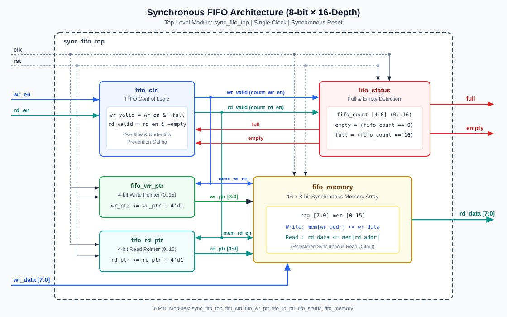

# Synchronous FIFO Architecture Specification

## 1. Design Overview

This design implements a **synchronous, single-clock, 8-bit wide × 16-location deep FIFO** (`sync_fifo_top`) using modular synthesizable Verilog-2001 RTL. All sequential elements share a single rising-edge clock (`clk`) and active-high synchronous reset (`rst`).



## 2. Top-Level Interface (`sync_fifo_top`)

| Port | Direction | Width | Description |
| :--- | :--- | :--- | :--- |
| `clk` | Input | 1 | System clock (rising-edge triggered) |
| `rst` | Input | 1 | Active-high synchronous reset |
| `wr_en` | Input | 1 | Write enable request |
| `wr_data` | Input | 8 | Write data bus |
| `rd_en` | Input | 1 | Read enable request |
| `rd_data` | Output | 8 | Registered read data output |
| `full` | Output | 1 | High when FIFO holds 16 unread bytes (`fifo_count == 16`) |
| `empty` | Output | 1 | High when FIFO holds 0 unread bytes (`fifo_count == 0`) |

## 3. Module Hierarchy & Responsibilities

```
sync_fifo_top
├── u_fifo_ctrl   (fifo_ctrl)   : Overflow/underflow request gating
├── u_fifo_wr_ptr (fifo_wr_ptr) : 4-bit write address counter (0..15)
├── u_fifo_rd_ptr (fifo_rd_ptr) : 4-bit read address counter (0..15)
├── u_fifo_status (fifo_status) : 5-bit occupancy counter & full/empty flags
└── u_fifo_memory (fifo_memory) : 16 x 8 synchronous storage + registered read
```

### 3.1 `fifo_ctrl` — FIFO Control Logic
Generates qualified write and read strobes by masking external requests against the current status flags:
- `wr_valid = wr_en & ~full` -> drives `mem_wr_en`, `wr_ptr_inc`, `count_wr_en`
- `rd_valid = rd_en & ~empty` -> drives `mem_rd_en`, `rd_ptr_inc`, `count_rd_en`

**Design invariants:**
1. When `full == 1`, `wr_valid` is forced to `0`, preventing pointer advancement, occupancy corruption, or overwrite of unread memory locations (**overflow prevention**).
2. When `empty == 1`, `rd_valid` is forced to `0`, preventing read pointer advancement, count underflow, or invalid updates to `rd_data` (**underflow prevention**).
3. Whenever `wr_valid && rd_valid` are simultaneously `1`, occupancy is strictly `0 < fifo_count < 16`, guaranteeing `wr_ptr != rd_ptr` (zero read/write address collision).

### 3.2 `fifo_wr_ptr` — Write Pointer Logic
- 4-bit synchronous up-counter (`wr_ptr[3:0]`).
- Resets to `4'd0` on `rst == 1`.
- Increments by `4'd1` on `posedge clk` when `wr_inc == 1`.
- Automatically wraps from `4'd15` (`4'hF`) to `4'd0` (`4'h0`) via 4-bit modulo-16 binary addition.

### 3.3 `fifo_rd_ptr` — Read Pointer Logic
- 4-bit synchronous up-counter (`rd_ptr[3:0]`).
- Resets to `4'd0` on `rst == 1`.
- Increments by `4'd1` on `posedge clk` when `rd_inc == 1`.
- Automatically wraps from `4'd15` (`4'hF`) to `4'd0` (`4'h0`) via 4-bit modulo-16 binary addition.

### 3.4 `fifo_status` — Full and Empty Detection
- Maintains a 5-bit synchronous occupancy counter `fifo_count[4:0]` representing `0` through `16`.
- State transitions on `posedge clk`:
  - `rst == 1`: `fifo_count <= 5'd0`
  - `{wr_valid, rd_valid} == 2'b10` (write only): `fifo_count <= fifo_count + 5'd1`
  - `{wr_valid, rd_valid} == 2'b01` (read only): `fifo_count <= fifo_count - 5'd1`
  - `2'b11` (simultaneous R/W) or `2'b00` (idle): `fifo_count` holds steady
- Status flags:
  - `empty = (fifo_count == 5'd0)`
  - `full  = (fifo_count == 5'd16)`
- Because `fifo_count` is registered, `full` and `empty` transition glitch-free synchronously after each clock edge, with zero combinational loops back through `fifo_ctrl`.

### 3.5 `fifo_memory` — FIFO Memory Array
- 16-entry × 8-bit register array (`reg [7:0] mem [0:15]`) with registered `rd_data`.
- **Synchronous reset (`rst == 1`)**: Clears all 16 memory locations and `rd_data` to `8'h00`, preventing `X`-propagation in simulation and ensuring deterministic startup hardware state.
- **Synchronous write (`wr_en == 1`)**: Stores `wr_data` into `mem[wr_addr]` at `posedge clk`.
- **Synchronous registered read (`rd_en == 1`)**: Captures `mem[rd_addr]` onto `rd_data` at `posedge clk` (1-clock read latency, eliminating combinational output paths from the memory mux to chip output pins).

## 4. Cycle-Accurate Timing Behavior

```
Cycle      :   |  Reset  |  Write A  |  Read A   | Sim R/W |
clk        : __|‾‾|__|‾‾|__|‾‾|__|‾‾|__|‾‾|__|‾‾|__|‾‾|__|‾‾|
rst        : ‾‾‾‾‾‾‾‾‾‾‾|____________________________________
wr_en      : ___________|‾‾‾‾‾‾‾‾‾‾‾|___________|‾‾‾‾‾‾‾‾‾‾‾|
wr_data    :   XXXXXXXX |    0xA5   |   0x00    |   0xB2    |
rd_en      : _______________________|‾‾‾‾‾‾‾‾‾‾‾|‾‾‾‾‾‾‾‾‾‾‾|
empty      : ‾‾‾‾‾‾‾‾‾‾‾‾‾‾‾‾‾‾‾‾‾‾‾|___________|‾‾‾‾‾‾‾‾‾‾‾| (stays 0 if count>0)
rd_data    :   0x00     |   0x00    |   0x00 -> |   0xA5    |
```

1. **Write Latency**: When `wr_en=1` (with `full=0`) is sampled at `posedge clk`, `wr_data` is stored in `mem[wr_ptr]`, `wr_ptr` increments, and `empty` deasserts immediately after that clock edge.
2. **Read Latency**: When `rd_en=1` (with `empty=0`) is sampled at `posedge clk`, `rd_data` updates to `mem[rd_ptr]` immediately after that clock edge, `rd_ptr` increments, and `full` deasserts if the FIFO was full.

